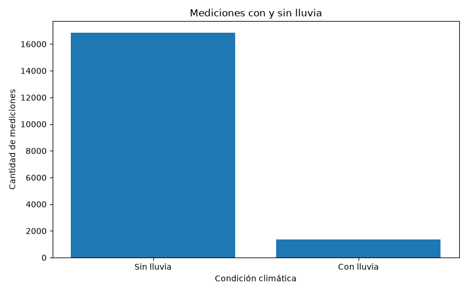
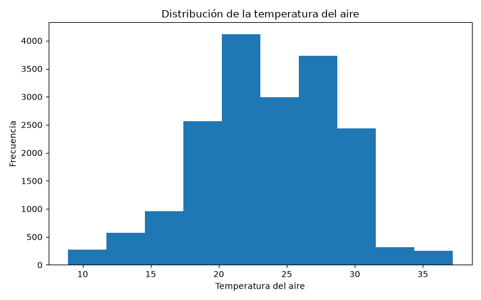

# Analizador de Datos - Fórmula 1

## 1. Descripción del proyecto

Este proyecto consiste en desarrollar un analizador de datos utilizando Python. El programa trabaja con información meteorológica relacionada con la Fórmula 1 durante las temporadas 2018 a 2023.

El usuario puede cargar un archivo CSV, explorar sus datos, calcular estadísticas, filtrar registros y generar gráficos desde un menú interactivo por consola.

## 2. Tecnologías utilizadas

- Python 3.12
- Pandas 3.1.1
- Matplotlib 3.11.2
- JSON
- Logging
- Git y GitHub
- Visual Studio Code

## 3. Dataset

**Archivo:** `f1_weather_2018_2023.csv`

El dataset contiene 18.214 registros y 10 columnas.

Entre las variables disponibles se encuentran:

- Time: tiempo de la medición.
- AirTemp: temperatura del aire.
- Humidity: humedad.
- Pressure: presión atmosférica.
- Rainfall: indicador de lluvia.
- TrackTemp: temperatura de pista.
- WindDirection: dirección del viento.
- WindSpeed: velocidad del viento.
- Round Number: número de carrera.
- Year: año.

**Fuente del dataset:** [Kaggle - F1 Weather Extract using FastF1](https://www.kaggle.com/code/quantumkaze/f1-weather-extract-using-fastf1/output).

## 4. Instalación y ejecución

Primero, crear un entorno virtual:

```powershell
py -m venv .venv
```

Activar el entorno virtual:

```powershell
.\.venv\Scripts\Activate.ps1
```

Instalar las dependencias:

```powershell
python -m pip install -r requirements.txt
```

Ejecutar el programa:

```powershell
python main.py
```

## 5. Funcionalidades

El programa cuenta con seis opciones:

1. **Cargar dataset:** lee el archivo CSV y muestra sus dimensiones.
2. **Ver información general:** muestra las primeras filas, columnas, tipos de datos y valores vacíos.
3. **Estadísticas:** calcula cantidad, promedio, mínimo, máximo y mediana de una columna numérica.
4. **Filtrar datos:** permite buscar registros según una categoría o valor.
5. **Generar gráficos:** crea un gráfico de barras y un histograma.
6. **Salir:** guarda los resultados en un archivo JSON y finaliza el programa.

## 6. Gráficos generados

Los gráficos se guardan como imágenes PNG dentro de la carpeta `graficos/`.

### Gráfico de barras

Compara la cantidad de mediciones con lluvia y sin lluvia.



### Histograma

Muestra la distribución de las temperaturas del aire registradas.



## 7. Archivos de resultados

- `resumen.json`: almacena las dimensiones del dataset, las columnas, las estadísticas y los gráficos generados.
- `anal
